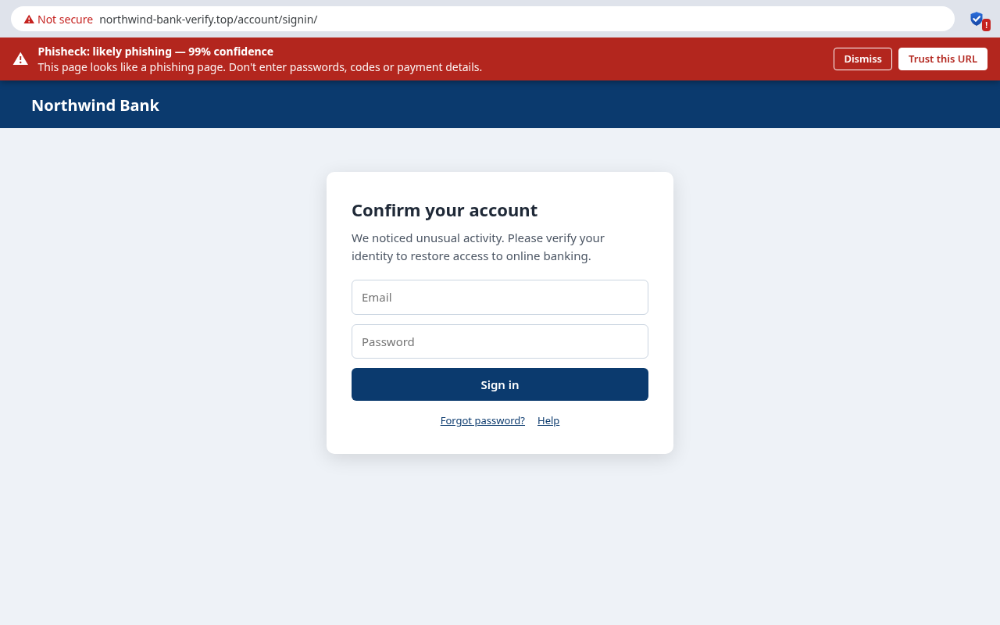
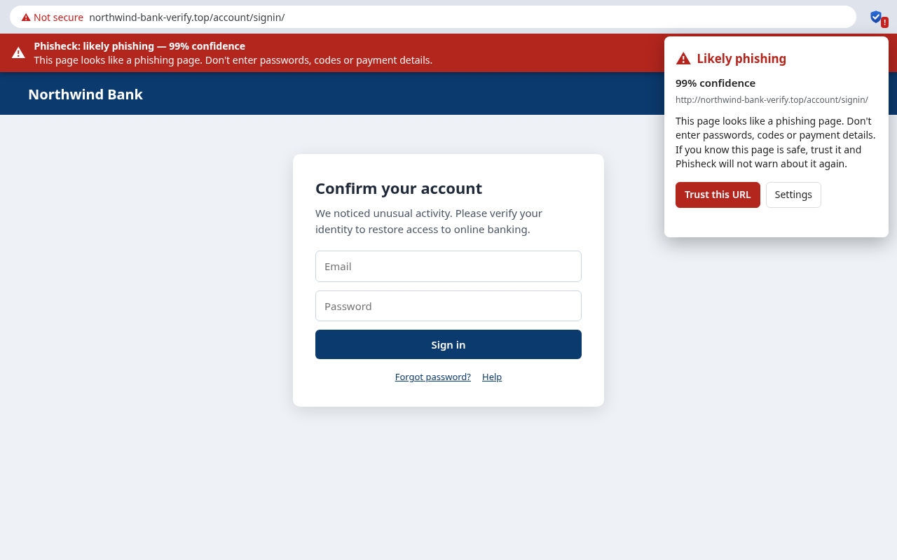

# Phisheck

**Phishing warnings for Chrome, computed entirely on your computer.**

Phisheck checks every page you open with a machine-learning model that runs inside the
extension. If a page looks like phishing, a red bar appears at the top of the page and the
toolbar button shows a red badge. Nothing is shown for normal pages. Phisheck makes no network
requests: no page address or content ever leaves your machine.

This repository contains everything that runs in your browser: the extension, the feature
extractor, the model runtime and the trained model. Its tests show that the extension works
offline and never sends anything anywhere. The data and pipeline used to train the model are
not published.



| On 1,974 live pages from sites not used in training | Value at the default threshold (80%) |
|---|---|
| Phishing pages detected | **88.6%** (405 / 457) |
| Legitimate pages flagged | **2.0%** (30 / 1,517) |
| Feature extraction / inference per page (p95) | **7.8 ms / 0.11 ms** |

## Features

- **Banner and badge** on flagged pages, with the model's confidence. The banner is a
  non-blocking bar in a Shadow DOM: page styles can't change or hide it, and it doesn't move the
  page.
- **Dismiss** a warning for this visit, or **Trust this URL** so it is never flagged again.
- **Settings:** an on/off switch, the warning threshold (50–99%), trusted pages, and trusted
  domains with or without their subdomains.
- **Single-page apps:** URL changes to a new path are checked again.
- **Incognito:** works there too, if you turn on *Allow in Incognito*.



## Privacy: verify it yourself

- **No network code:** `extension/e2e/privacy.test.ts` scans the built bundles for network APIs
  (fetch, XHR, WebSocket, beacons, …) and for URL loaders. It also compares all of Chromium's
  requests with and without the extension on the same pages; they must be identical.
- **Everything is bundled:** the extension pages use the default Manifest V3 content security
  policy, so no remote code can run. The model ships inside the package as
  `models/model.json`.
- **Local storage only:** settings and trusted pages stay on your computer and are never
  synced. Per-tab results are kept in memory until the tab closes.
- **Few permissions:** `webNavigation` and `scripting`, `storage`, and access to http(s) sites
  only:

  | Permission | Used for |
  |---|---|
  | `webNavigation` | Noticing when a tab opens a new page, including single-page-app URL changes |
  | `scripting` + http(s) sites | Running the check inside the pages you open, without a click |
  | `storage` | Your settings, and each tab's current result |

- Full policy: [PRIVACY.md](PRIVACY.md).

## Install (load unpacked)

1. Build the extension (see [Build and test](#build-and-test)), or run `npm run package` and
   unzip `release/phisheck-<version>.zip`.
2. In Chrome (version 120 or later), open `chrome://extensions` and turn on **Developer mode**.
3. Click **Load unpacked** and choose `extension/dist` (or the unzipped package).
4. Optional: to test locally, run `node extension/scripts/serve-fixtures.mjs` and open
   <http://localhost:8080/signin/> (flagged) and <http://localhost:8080/blog/spring-planting/>
   (not flagged).

## How it works

```
  ┌──────────────────── Chrome extension (your computer) ─────────────────┐
  │ service worker: navigation events, inference, trusted list, badge     │
  │ content script: URL + DOM features ──► service worker; shows banner   │
  │ popup (flagged tabs only) · settings page                             │
  └────────────────────────────────────────────────────────────────────────┘
```

1. On each main-frame navigation, and on a single-page-app change to a new path, the service
   worker injects the content script. Nothing runs when protection is off or the page is
   trusted.
2. The content script waits for the page to settle (load, then up to 3 s for the network to go
   quiet). The feature extractor (`shared/src/features`) then turns the URL and the live DOM
   into 50 numbers: URL and host lexical features, brand and keyword signals, link and resource
   ratios, and form features.
3. The service worker scores the vector with a LightGBM model (755 trees, `models/model.json`).
   A small pure-TypeScript tree evaluator (`shared/src/model-runtime`, no dependencies) does the
   scoring. It refuses a model built for a different feature schema.
4. If the probability reaches your threshold, the tab gets the banner, the badge and the popup.

The same extractor code produced the training data: the crawler injected it into headless
Chromium, so the model sees identical features in training and in your browser.

## Repository layout

```
extension/  MV3 extension: src/{background,content,popup,settings}, e2e/ tests, scripts/, icons/
shared/     features/ (the extractor) and model-runtime/ (TS tree evaluator)
models/     model.json: the trained model shipped in the extension
```

## Build and test

Requirements: Node.js 22 or later.

```sh
git clone https://github.com/parentemarcelo/Phisheck.git
cd Phisheck
npm ci
npx playwright install chromium   # browser for the DOM-parity and extension tests
npm run build                     # → extension/dist/
npm run check                     # lint, format, typecheck, unit and extension E2E tests
```

| Task | Command |
|---|---|
| Build the extension → `extension/dist/` | `npm run build` |
| Release zip → `release/phisheck-<version>.zip` (deterministic) | `npm run package` |
| All checks | `npm run check` |
| Tests only | `npm test` |
| Format | `npm run format` |

The extension E2E tests load `extension/dist` in Playwright's Chromium, serve fixture pages
through request routing and never touch the network.

## Licence

[MIT](LICENSE)
